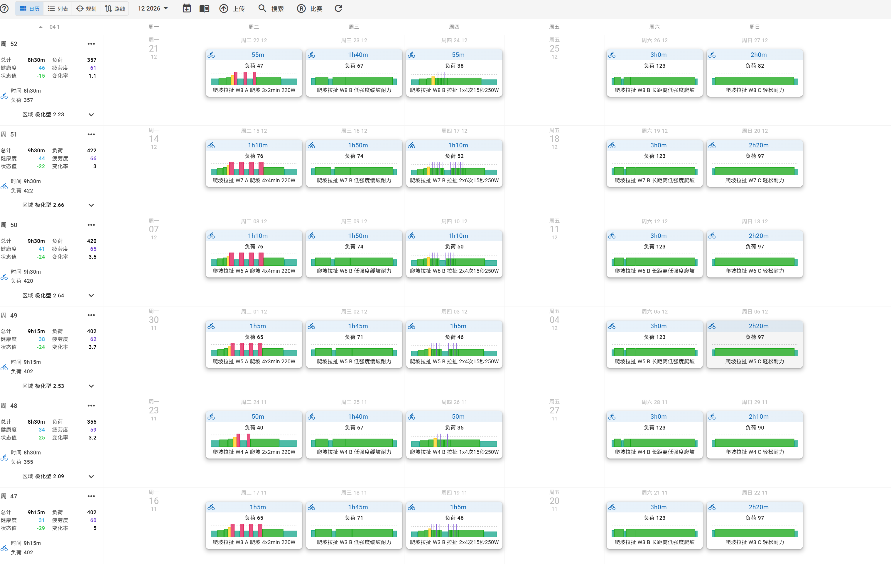
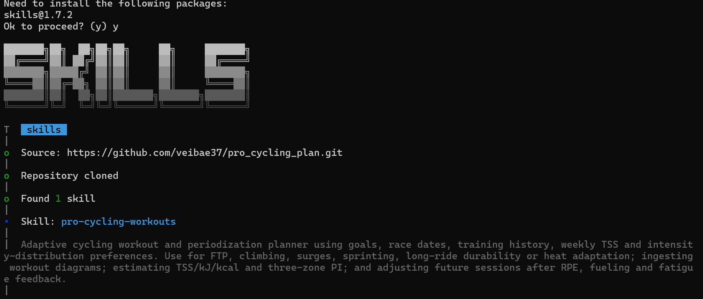

**简体中文** · [English](README.en.md)

# Pro Cycling Plan & Workouts

**目标导向排课 · 职业课表缩放 · 负荷核算 · Intervals.icu MCP**

从 FTP、爬坡到反复拉扯与长距离耐受：先确定目标与约束，再安排周期、选择课表，并根据骑后反馈调整。

[查看演示](#showcase) · [骑手分类](#classification) · [安装技能](#installation) · [连接 Intervals.icu](#intervals-mcp) · [更多资料](#usage)

> [!NOTE]
> 安装Skill后可由Agent按目标编排训练；写入日历还需单独连接并授权Intervals.icu MCP。

<a id="showcase"></a>

## Showcase / 从一句输入到八周训练日历

**输入目标 → 编排周期 → 核算负荷 → 授权导入 → 骑后调整**

### 你的输入

> 使用 pro-cycling-workouts：体重70 kg、FTP 200 W，想提高爬坡和反复拉扯能力，无力量训练。从2026年11月开始安排8周极化训练，PI希望高于1.5。每周最多10小时，周一、周五休息，最长单次3小时，周TSS在350–450之间。请生成课表并通过MCP写入Intervals.icu。

### 得到的计划

**8 周 · 40 节训练 · 每周 8.5–9.5 小时 · 周 TSS 355–422**

- **骑手画像**：FTP **200 W / 2.86 W/kg**，按当前训练史、时间预算和恢复缩放课表。
- **训练结构**：周二爬坡间歇，周四受控拉扯；周三、周六安排低强度缓坡与耐力，周日为可删减的轻松骑。
- **周期推进**：前3周渐进构建，第4周减少高强度；第5–7周增加专项容量，第8周恢复并比较同协议主组完成质量。
- **实际交付**：40节结构化训练已导入并读回核对，日期、功率、展开后的间歇与恢复次数、时长一致。设备端同步需另行验证。

<details>
<summary><strong>展开八周负荷与强度分布</strong></summary>

周期为 **2026-11-02 至 2026-12-27**，时区为 Asia/Singapore。下面的 TSS 为平台读回值，PI 为目标功率下的代理估计。

- **W1 · 11/02–11/08**：8h30m，**358 TSS**，PI **2.29**；从3×2分钟爬坡主组起步。
- **W2 · 11/09–11/15**：8h50m，**379 TSS**，PI **2.43**；延长为3×3分钟。
- **W3 · 11/16–11/22**：9h15m，**402 TSS**，PI **2.53**；增加为4×3分钟。
- **W4 · 11/23–11/29**：8h30m，**355 TSS**，PI **2.09**；减少高强度容量，检查恢复。
- **W5 · 11/30–12/06**：9h15m，**402 TSS**，PI **2.53**；恢复后回到4×3分钟。
- **W6 · 12/07–12/13**：9h30m，**420 TSS**，PI **2.64**；延长为4×4分钟。
- **W7 · 12/14–12/20**：9h30m，**422 TSS**，PI **2.66**；增加受控拉扯重复次数。
- **W8 · 12/21–12/27**：8h30m，**357 TSS**，PI **2.23**；减少高强度，重复首周主组比较完成质量。

三强度区暂用 **70% / 100% FTP（140 / 200 W）** 作代理边界，低区时间占多数且高区多于中区；这不是实测 LT1/LT2，也不能把普通 FTP 七区直接当作三生理强度区。按功率统计的短间歇时间不等于实际高摄氧或高心率时间。

恢复周保留较多低强度时间，是350 TSS下限要求下的折中。此案例不适用于所有骑手；明显疲劳时应减课，允许低于目标，不追补TSS。

</details>

<details>
<summary><strong>展开代表课：60 分钟爬坡间歇 · 约 51 TSS · 460 kJ</strong></summary>

首周周二主组为 **3×2分钟220 W**，两次组间恢复各4分钟100 W。选择安全连续坡或骑行台，不强制低踏频大扭矩。

```text
Warmup
- 5m 50%
- 5m 60%
- 3m 65%
- 2m 80%

Climb repeats 2x
- 2m 110%
- 4m 50%

Last climb
- 2m 110%

Easy endurance
- 21m 65%

Cooldown
- 10m 50%
```

时长为 `15 + 6 + 8 + 21 + 10 = 60 min`。按FTP 200 W计算，计划NP约 **142.5 W**、TSS **50.77**、机械做功 **459.6 kJ**；假设机械效率20–25%，骑行消耗粗估 **439–549 kcal**。

骑中碳水可从已耐受的40–50 g/h起步，按胃肠反应调整；补水按环境与个人出汗量安排。热身明显比平时吃力时可缩短或休息。

[下载训练文本](examples/climbing-surges-60m.txt) · [查看核算口径](references/load-and-distribution.md)

```powershell
python -X utf8 scripts/plan_metrics.py --workout examples/climbing-surges-60m.txt --ftp 200
```

保留循环后的空行，避免后续步骤被卷入重复组。骑后反馈全课/末组RPE、完成情况、补给与主要限制感，即可修订后续训练。

</details>

### 在 Intervals.icu 中查看结果



截图展示同一计划的 **W3–W8**，最新周在上方：周一、周五留空休息，周二为爬坡间歇，周四为拉扯训练，周末以低强度耐力为主。左侧可核对周时长、TSS与PI；例如W7为 **9h30m / 422 TSS / PI 2.66**，W8为 **8h30m / 357 TSS / PI 2.23**。

左侧健康度、疲劳等数值为平台对未来已排训练的推算，不代表这些训练已经完成或保证带来相应提升。截图中的PI也应结合上述代理阈值理解。

<a id="classification"></a>

## 1. Classification / 骑手分类

### 功体比：模板起点

默认FTP功体比启发式分档如下。档位用于选择缩放模板，不代表职业水平，也不能覆盖训练史、时间预算与恢复。

- **Full Pro · ≥4.5 W/kg**：保留较完整的职业课表结构，仍需确认训练容量与执行条件。
- **Scaled · ≥3.2 且 <4.5 W/kg**：减少主组容量、适当延长恢复，常用75–120分钟候选课。
- **Double-Scaled · <3.2 W/kg**：进一步减少主组容量和高强度峰值，常用50–75分钟候选课。

有有效FTP时优先使用；只给CP20时先补问可选成绩或读取历史曲线，不统一默认乘0.95。CP60也需核对测试协议，CP1/FTP仅作短时能力参考。分组预测及功体比分档的依据和限制见[功率画像流程](references/power-profile-workflow.md)。

### 还要考虑哪些条件

- **目标与日期**：FTP、爬坡、反复提速、冲刺、长骑耐受或热适应；先选主要目标，再倒排阶段。
- **周时间与负荷**：近期真实骑行量、最长骑行、周TSS目标/上限、每日可用时长与固定休息日。
- **强度分布**：极化或金字塔偏好，以及实测LT1/LT2；没有阈值时明确标注代理假设。
- **力量与恢复**：腿部力量训练、睡眠、酸痛、热环境与最近完成质量都占恢复预算。
- **年龄与场景**：结合训练经历与个人反应调整；室内考虑散热和连续踩踏，户外考虑地形、齿比和安全。

<a id="installation"></a>

## 2. Installation / 安装技能

### 推荐：交互式安装

```bash
npx skills add veibae37/pro_cycling_plan
```

按安装器提示选择目标工具与项目/用户范围。安装后直接说“使用 pro-cycling-workouts”，或使用客户端支持的技能调用方式。

<details>
<summary><strong>查看安装界面</strong></summary>



该界面表示仓库已克隆、技能已识别；之后仍需确认安装。它不代表Intervals.icu账号已经连接。

</details>

### 手动安装与其他环境

保留完整仓库，不要只复制`SKILL.md`；Agent还需要访问`references/`、`scripts/`、`src/`和`mcp/`。

<details>
<summary><strong>展开各客户端安装位置</strong></summary>

**Codex desktop / CLI / IDE extension**

```powershell
git clone https://github.com/veibae37/pro_cycling_plan.git "$env:USERPROFILE/.agents/skills/pro-cycling-workouts"
```

个人范围使用`~/.agents/skills/`；项目范围使用项目内的`.agents/skills/`。调用`$pro-cycling-workouts`或直接说明要使用该技能。目标目录已存在时更新原目录，不覆盖克隆。[官方技能文档](https://learn.chatgpt.com/docs/build-skills)

**Claude Code**

个人范围使用`~/.claude/skills/pro-cycling-workouts/`，项目范围使用`.claude/skills/pro-cycling-workouts/`。通过`/pro-cycling-workouts`或自然语言调用。[技能文档](https://code.claude.com/docs/en/skills)

**Cursor / Windsurf / Cascade**

Cursor使用其支持的用户技能目录或项目内`.cursor/skills/`；Windsurf/Cascade使用客户端支持的`.windsurf/skills/`或新版`.devin/skills/`。使用原生技能文件夹，不把`SKILL.md`改名为`.mdc`。[Cursor文档](https://cursor.com/docs/skills) · [Cascade文档](https://docs.devin.ai/desktop/cascade/skills)

**Gemini CLI**

```powershell
gemini skills install https://github.com/veibae37/pro_cycling_plan.git
gemini skills list --all
```

MCP在客户端的`mcpServers`中另外配置。[技能文档](https://geminicli.com/docs/cli/skills/)

**Claude Projects / ChatGPT Projects / Custom GPTs**

上传`SKILL.md`、Markdown参考文件以及`scripts/`、`src/`中的Python文件，再使用[Claude适配指令](adapters/claude-project-instructions.md)或[ChatGPT适配指令](adapters/chatgpt-custom-gpt-prompt.md)。支持执行时需保留目录结构；能否运行工具取决于客户端的代码执行能力。

上传文件不会连接账号。网页环境需要受支持的远程MCP/插件连接或隧道；本仓库基础服务仅提供本地stdio，不会读取网页项目之外的本机配置。

</details>

<a id="intervals-mcp"></a>

## 3. Intervals.icu MCP / 连接训练日历

### 准备账号与运行环境

1. 在[Intervals.icu设置](https://intervals.icu/settings)的Developer Settings中生成API Key，并确认Athlete ID。
2. 在仓库根目录创建Python虚拟环境，安装与当前`FastMCP`接口兼容的依赖。
3. 把MCP配置合并到客户端的私人设置中，再启动连接并先测试账号读取。

```powershell
python -m venv .venv
.\.venv\Scripts\python.exe -m pip install -r requirements.txt
```

使用Python 3.10+，依赖必须装在客户端`command`使用的同一个环境中，包含MCP 1.x、HTTPX和时区数据；macOS/Linux请改用`.venv/bin/python`。

> [!IMPORTANT]
> API Key只保存在私人本地配置中，不要发到聊天、README或Git仓库。下列账号与密钥均为占位符。现有MCP设置应合并保留，不要整文件覆盖。

<details>
<summary><strong>Codex 配置：TOML</strong></summary>

合并到私人用户配置`~/.codex/config.toml`，替换绝对路径和凭据：

```toml
[mcp_servers.intervals-icu]
command = "C:/path/to/pro_cycling_plan/.venv/Scripts/python.exe"
args = ["C:/path/to/pro_cycling_plan/mcp/intervals_mcp_server.py"]

[mcp_servers.intervals-icu.env]
INTERVALS_ATHLETE_ID = "i123456"
INTERVALS_API_KEY = "REPLACE_WITH_YOUR_API_KEY"
```

重启客户端后检查MCP连接，或运行`codex mcp list`。[官方MCP文档](https://learn.chatgpt.com/docs/extend/mcp?surface=cli)

</details>

<details>
<summary><strong>Claude / Cursor / Cascade 配置：JSON</strong></summary>

把条目合并到客户端支持的`mcpServers`配置中：

```json
{
  "mcpServers": {
    "intervals-icu": {
      "command": "C:/path/to/pro_cycling_plan/.venv/Scripts/python.exe",
      "args": ["C:/path/to/pro_cycling_plan/mcp/intervals_mcp_server.py"],
      "env": {
        "INTERVALS_ATHLETE_ID": "i123456",
        "INTERVALS_API_KEY": "REPLACE_WITH_YOUR_API_KEY"
      }
    }
  }
}
```

Claude Desktop可从Settings → Developer → Edit Config打开配置；Claude Code项目配置为`.mcp.json`；Cursor支持`~/.cursor/mcp.json`或项目内`.cursor/mcp.json`。含凭据的项目配置应排除在Git之外。Cascade请从客户端设置中打开MCP配置。

[Claude Code MCP](https://code.claude.com/docs/en/mcp) · [Cursor MCP](https://cursor.com/docs/mcp) · [Cascade MCP](https://docs.devin.ai/desktop/cascade/mcp)

</details>

### 使用流程

**读取训练史 → 保存档案与计划 → 检查约束 → 预览 → 授权更新 → 回读核对。**

计划工具可识别重复ID、沿用修订前的课程ID，并在写入后核对解析功率与时长。预览失效时先刷新；Garmin/Wahoo/Zwift等设备端同步需另外确认。

<a id="usage"></a>

## 4. Further Reading / 更多资料

**统一课表核算 · 时间与负荷检查 · 档案和计划版本 · 日历查重与验证 · ZWO/ICS离线导出**

无需连接账号，也能验证和导出上面的代表课：

```powershell
python -X utf8 scripts/training_plan.py validate --plan examples/portable-plan.json --profile examples/athlete-profile.json
python -X utf8 scripts/training_plan.py export --plan examples/portable-plan.json --out .training-state/exports/showcase
```

档案中的训练史与恢复状态是测试用虚构数据，正式训练前请替换。[格式、反馈与命令说明](docs/IMPLEMENTATION.md#8-offline-export-and-commands)。

- [训练规划规则](SKILL.md)：目标采集、排课、输出和反馈流程。
- [周期化规划](references/goal-periodization.md)与[反馈循环](references/feedback-loop.md)：阶段安排、复测及骑后调整。
- [功率画像与追问流程](references/power-profile-workflow.md)：可选6s至60m成绩、默认历史回溯MCP、按训练水平给出P60候选；附研究依据与[阈值评估路线](references/power-curve-assessment-plan.md)。

---

**简体中文** · [English](README.en.md)

了解排课流程、计算公式、MCP工具和实现边界：[Implementation Details（英文）](docs/IMPLEMENTATION.md)。

本项目采用 [Apache License 2.0](LICENSE)。
