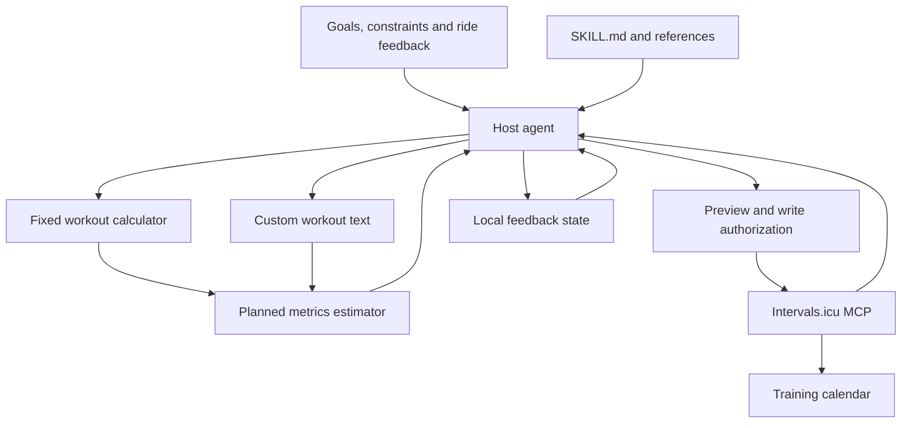

# Implementation Details

This document explains the planning workflow, numerical methods, MCP behavior and current implementation limits of Pro Cycling Plan & Workouts. It describes the portable code shipped in this repository. The agent authors plans; deterministic tools calculate, validate, version, export and synchronize them.

[English README](../README.en.md) · [Chinese README](../README.md)

## 1. Components and responsibilities

The system combines agent instructions with a shared Python workout representation and an optional account connection:

- **[SKILL.md](../SKILL.md) and [references](../references/):** define intake, goal-based periodization, workout selection, output requirements and feedback handling. The host agent reads and applies these instructions.
- **[src/tier_calculator.py](../src/tier_calculator.py):** implements `RiderProfile.analyze()`, fixed workout generation and a predefined weekly summary.
- **[scripts/plan_metrics.py](../scripts/plan_metrics.py):** parses supported workout text and estimates duration, mechanical work, energy expenditure, NP/TSS and optional three-zone PI.
- **[mcp/intervals_mcp_server.py](../mcp/intervals_mcp_server.py):** exposes account reads and calendar writes through a local stdio MCP server.



The host agent orchestrates this workflow. Installing a skill does not start an MCP server, authenticate an account or turn the fixed calculator into an eight-week optimizer. Editing instructions also does not change Python behavior.

## 2. Goal-based planning and feedback

The agent uses [goal-periodization.md](../references/goal-periodization.md) to translate a primary goal into phases and sessions:

1. Collect the goal, dates, recent training, available time, weekly TSS target/cap, distribution preference, recovery constraints and threshold information.
2. Arrange build, recovery, specific-work and assessment phases within the available dates.
3. Assign A/B/C priorities and select or author workouts that serve the goal. Priority and exercise intensity are separate concepts.
4. Expand the final steps and check duration, weekly totals, load and intensity distribution using the metrics tool where supported.
5. Preview the plan and use an authorized account connection for calendar writes.
6. Apply actual completion, RPE, fueling and recovery feedback before changing subsequent sessions.

Recovery and demonstrated capacity take precedence over template tiers. Added available hours are not automatically prescribed training hours. Missed training is not a TSS debt, and fatigue can justify canceling even an A-priority session.

The fixed CLI/MCP generation interface does not accept goal dates, race dates, cycle length, weekly TSS targets, PI targets or heat-adaptation settings. Those constraints are handled by the agent's planning workflow, not by a hidden optimization engine.

## 3. Fixed rider analysis and scaling

This section describes the compatibility calculator, not mandatory Agent planning policy. The Skill now prioritizes progressive questions, goal/history/recovery-based doses and transparent provisional P20-to-P60 estimates when detailed answers are unavailable. Agents may draft custom plans rather than select a W/kg tier or replicate a Pro template. Existing tool validation does not require withholding a clearly labeled provisional/RPE plan or inventing maximal-test evidence to satisfy a writer's inputs.

### FTP inputs and short-duration power

`RiderProfile.analyze()` prefers an explicitly supplied FTP/P60 working reference. CP20-only input now requires follow-up rather than silently multiplying by 0.95. The CLI returns an intake response; the compatibility generation MCP returns `needs_power_profile` without network calls until an explicit performance group, basis and acceptance are supplied.

Declared groups may use the [Sitko et al. 2023](https://pubmed.ncbi.nlm.nih.gov/37802084/) P60 prediction factors: recreational 0.88, trained 0.92, well-trained 0.95 and professional 0.96. The study grouped by VO2max, not FTP W/kg. Group basis is recorded as `vo2max_report`, `self_report` or explicitly weaker `wkg_heuristic`. These predict P60, not measured FTP/LT2. Group-model validation MAE is not an individual confidence interval.

The unsupported CP1-driven 0.92/0.96 conversion branches have been removed. CP1 ratios now use the selected working reference and remain template hints, not measurements of W′, VLamax or muscle fibers.

`scripts/power_profile.py` provides offline intake and an actual MCP stdio read-only trial. `prepare_power_profile`, `get_power_curve_evidence` and `get_steady_ride_evidence` expose optional inputs, 42/90/365d curves, observational CP diagnostics and descriptive steady-ride windows. See the [workflow](../references/power-profile-workflow.md) for commands, provenance, API bounds and limits. No threshold is automatically adopted; dedicated assessment persistence and migration remain planned.

### Tier and volume modifiers

The implementation rounds effective FTP/weight to two decimal places before tier comparison. Default `male` thresholds are 4.5 and 3.2 W/kg; the `female` branch uses 3.9 and 2.8. The Python class accepts `sex`, but the current CLI and MCP generation function do not expose it.

Base interval scales are 1.00 for Full Pro, 0.65 for Scaled and 0.45 for Double-Scaled. They are combined with:

- **Strength:** `none = 1.00`, `moderate = 0.80`, `heavy = 0.65`. Heavy strength also caps the recommended spike target at 130% FTP.
- **Age:** `<30 = 1.00`, `30–44 = 1.00`, `45–54 = 0.85`, `55+ = 0.75`. The latter three groups add 30/45/60 seconds of recovery; the two oldest groups contribute intensity offsets of −2/−4 percentage points.
- **Weekly hours:** endurance multipliers are 0.75, 1.00 and 1.20 for `0-5`, `5-10` and `10+`.
- **Environment:** indoor endurance multiplier 0.65 and intensity offset −3 percentage points; outdoor multiplier 1.00 and offset 0.

```text
interval_scale = max(0.30, round(base_scale × strength_scale × age_scale, 2))
endurance_scale = max(0.40, round(environment_scale × weekly_hours_scale, 2))
```

Model-specific rounding, minimum repetitions, duration floors and intensity floors then determine the emitted steps. An intensity offset is not a universal percentage reduction applied to every segment. These heuristics do not guarantee that the result fits an individual's actual schedule or recovery.

### Models and weekly summaries

Supported model identifiers are `lt1`, `fast_vo2`, `lt2`, `z3_z4_spikes`, `vo2_over_under`, `short_30_30` and `recovery`. The recovery model now contains only easy riding, without forced sprint primers. Rest may still be more appropriate when fatigue is high. Unknown model names fail instead of falling back to recovery.

`generate_weekly_microcycle()` selects predefined days/models using the weekly-hours category. It does not solve for the requested hours, TSS, distribution, race goals or strength-training calendar. Its generated sessions also need review against the skill's planning rules.

### One workout representation

Every generated or imported workout is expanded into immutable `Workout`/`Step` objects in [workout.py](../src/workout.py). Each step stores exact integer seconds and a low/high percentage of FTP. Metrics, native calendar text and ZWO exports use those same steps, including final-repeat recoveries and age-related recovery extensions.

The generator preserves its existing result keys and adds `duration_seconds`, `workout` (schema version 1) and `metrics`. `total_duration_min` is now a decimal display value; use exact seconds for writes. TSS and work no longer use fixed model IF assumptions. Carbohydrate recommendations remain template heuristics.

```json
{"schema_version": 1, "steps": [{"duration_seconds": 60, "low_pct": 50, "high_pct": 60}]}
```

Range scenarios are `low`, `midpoint` (default) and `high`. Calendar and ZWO outputs resolve ranges into the chosen constant target, matching the calculated scenario. A range is not exported as a ramp.

## 4. Workout parsing and numerical estimates

### Supported text

`parse_workout()` supports constant/range `%FTP` steps and flat repeat groups ending in `Nx`. Blank lines or a new heading terminate the active group. Every step in a group is repeated, including a final recovery when it is present.

The README's [60-minute workout](../examples/climbing-surges-60m.txt) therefore repeats work/recovery twice, then explicitly adds the third effort. This avoids accidentally prescribing a third inter-repetition recovery.

Unsupported dash-prefixed steps raise an error rather than being silently discarded. Ramps, cadence targets, open-ended sprints, arbitrary step annotations and nested groups must first be converted into supported explicit steps. Duration must be positive, inputs finite, and a workout cannot exceed 48 hours.

### Work and energy expenditure

For a range, the default scenario uses the midpoint; `--range-scenarios` also calculates all-low and all-high target scenarios.

```text
power_W = FTP × target_percent / 100
work_kJ = Σ(power_W × duration_seconds) / 1000
kcal_low = work_kJ / (4.184 × 0.25)
kcal_high = work_kJ / (4.184 × 0.20)
```

The kcal range assumes 20–25% gross mechanical efficiency. It estimates ride energy expenditure, not daily energy needs or a requirement to replace every calorie during the ride. It is separate from carbohydrate, fluid and electrolyte guidance.

### NP, IF and TSS

The estimator expands targets into a one-second constant-power sequence. It uses complete trailing 30-second windows, averages the fourth powers of their means, then takes the fourth root:

```text
estimated_NP = mean(rolling_30s_mean(power)⁴)^(1/4)
IF = estimated_NP / FTP
TSS = duration_hours × IF² × 100
```

Sessions shorter than 30 seconds have no complete window, so NP/IF/TSS are unavailable. Average power is computed separately and is not substituted for NP.

`estimate_week()` sums per-session duration, work and TSS. It never computes one NP from a sequence stitched across sessions or rest days. Actual coasting, power variability, heat and local muscular fatigue are not captured fully by this target-based model. Platform calculation and rounding may also differ.

### Three-zone distribution and PI

Provide both LT1 and LT2 boundaries together, with LT1 below LT2. The estimator assigns target time at or below LT1 to the low zone, above LT1 through LT2 to the middle zone, and above LT2 to the high zone.

Let `p_low + p_mid + p_high = 1`, using fractions rather than percentages:

```text
PI = log10((p_low / p_mid) × p_high × 100)
```

- `polarized`: low > high > middle, all three zones are nonzero, and PI > 2.
- `pyramidal`: low > middle > high.
- Otherwise: `other_or_insufficient`.

If any zone has zero time, the tool reports PI as `null`; it does not add an artificial epsilon. A pyramidal classification can still accompany an undefined PI when high-zone time is zero.

Without individual physiological thresholds, either omit distribution or explicitly label a proxy scenario. The showcase's 70%/100% FTP boundaries are such a proxy, not measured LT1/LT2. Seven FTP power zones are not interchangeable with this three-zone system. Short-interval power-zone time does not measure high-oxygen-uptake time, and a higher PI alone is not evidence of a better plan.

## 5. Portable profiles and feasibility

The [profile fixture](../examples/athlete-profile.json) and [portable plan](../examples/portable-plan.json) reuse the README's 60-minute workout. Profile history and recovery are **synthetic acceptance fixtures**, not observed athlete data. Replace them before use. Their date-dependent warnings are intentional once these dates become stale.

A profile requires `schema_version: 1`, `profile_id`, `weight_kg`, `ftp: {watts, source, date}`, `timezone` and `availability: {weekly_hours, max_session_hours, rest_days}`. Dates use `YYYY-MM-DD`; rest days use Monday=0 through Sunday=6. Optional `daily_hours` maps string weekday numbers to hour caps. `language` is `en`/`zh`; `units` is `metric`/`imperial`, but stored power and weight always use W and kg. The host agent uses these preferences; saving them does not translate files or change client settings.

Optional inputs:

- `recent_weeks`: Monday `week_start`, observed `hours` and `tss`; missing values may be null.
- `thresholds`: `lt1_pct`, `lt2_pct`, and an explicit measured/proxy `source`.
- `wellness`: `date` and `fatigue` (`normal`, `high` or `unknown`).

A plan requires `schema_version: 1`, `plan_id`, `ftp` and `sessions`. Each session needs stable `session_id`, `date`, `name` and `workout` (supported native text or canonical JSON). Optional session fields are `sport` (`Ride`/`VirtualRide`) and `start_time` (`HH:MM`, athlete-local). Preserve IDs when revising steps or dates; use a new plan ID for a different training block. IDs accept 1-64 letters, numbers, hyphens and underscores.

Plan options include `power_range_scenario`, `weekly_tss_range`, `distribution` and `pi_min`. Distribution uses the profile's declared thresholds. This validator checks a supplied plan; it does not optimize an eight-week schedule.

[assess_plan](../src/planning.py) reports `ready`, `review` or `blocked`, weekly estimates, issues and suggested adjustments:

- **Hard conflicts:** fixed rest days; ride, combined daily or weekly hour caps; TSS above the requested upper bound; profile/plan FTP mismatch; future FTP date; undefined TSS from a sub-30-second session; high reported fatigue alongside quality work.
- **Review:** missing/stale history or recovery, aged FTP, load increases, consecutive quality days, TSS below a requested minimum, or unavailable/unmet distribution targets. Missing observations are not converted to zero or normal recovery.
- **Progression:** compare the first week with the mean of available observations from up to six preceding weeks, then successive planned weeks. `load_review_factor` defaults to 1.25 and is configurable. This is a review trigger, not a proven safe progression rate.
- **Quality spacing:** two accumulated minutes at >=105% FTP, or ten at >=90%, marks a quality day for this check. This is a scheduling heuristic, not a physiological diagnosis.

Correct hard conflicts or explicitly revise their underlying constraints. Warnings may be accepted with a reason grounded in the user's actual context. Existing write authorization remains valid; the preview token does not require a redundant permission question.

## 6. MCP transport and verified sync

Use Python 3.10+ and install [requirements.txt](../requirements.txt) in the interpreter configured by the host. The local stdio server uses MCP 1.x `FastMCP`, HTTPX, a 30-second timeout and an identifying User-Agent. Windows needs `tzdata` for IANA timezone validation. Set `INTERVALS_ATHLETE_ID` (default `0`, the API-key owner) and `INTERVALS_API_KEY`. Errors omit credentials, response bodies and private URLs; HTTPX URL logging is suppressed.

Fourteen tools are exposed:

- `get_athlete_profile`: identity, weight and sport settings; FTP/eFTP/W-prime availability depends on the returned settings.
- `get_recent_wellness_and_activities`: dated actual activity and wellness records.
- `prepare_power_profile`: offline optional-input questions and declared-group P60 scenarios; no network calls.
- `get_power_curve_evidence`: read-only 42/90/365d curves and minimal activity coverage, with source dates, provisional models and nonmaximal-effort handling.
- `get_steady_ride_evidence`: non-GPS stream read and descriptive continuous-window metrics; never an LT1 measurement.
- `get_calendar_events`: dated planned events, parsed steps and resolved power.
- `preview_training_plan(plan, profile)`: read-only feasibility/calendar comparison and `preview_hash`.
- `sync_training_plan(plan, profile, expected_preview_hash, review_note="")`: authorized upsert followed by verification. Warnings require a reason; hard conflicts block writes.
- `save_athlete_profile`, `save_training_plan`, `read_training_state`, `record_training_feedback`: private records described below.
- `create_intervals_workout`: compatibility single-session writer. Now requires explicit `ftp_watts`, derives exact seconds and rejects mismatched `moving_time_sec`.
- `generate_and_push_pro_workout`: compatibility fixed-template generator/writer. Defaults to CP20 intake; use `is_cp20=false` for a supplied FTP/P60 reference. P20-based generation requires a declared maximal effort, group/basis and explicit acceptance of the provisional estimate.

The two compatibility writers use the reliable sync core but do not perform full plan feasibility checks. Prefer the plan preview/sync tools for multiweek work.

### Write contract

1. Expand and validate the final plan, assess constraints and list existing calendar events.
2. Use stable `external_id` values `pcw-v1:<plan_id>:<session_id>`. The first description line identifies ownership, followed by a blank line and native steps. Do not send an empty `workout_doc`.
3. Preview `upsert`, `update` or `unchanged`. Absence in a lookup window does not prove global absence, so it is called upsert. Saved revisions widen lookup to include previous session dates.
4. Bind the preview hash to plan, profile, assessment and calendar snapshot; recheck before writing. Changed inputs return `stale_preview`. This reduces accidental overwrites; the external API offers no atomic compare-and-swap guarantee.
5. POST only pending events to `/events/bulk?upsert=true`, then read the calendar again. Verify date, sport, name, description, exact seconds, expanded power targets and resolved watts against planned FTP. HTTP 200 alone is insufficient.
6. After a timeout or partial application, read back and report per-session results without automatically retrying the write. A later explicitly initiated sync previews current state and upserts only remaining changes.

`verified` means the calendar representation and parsed targets match. Wrong account FTP, absent parsed steps or platform push errors fail verification. Delivery to Garmin/Wahoo/Zwift requires separate checking.

Duplicate external IDs and ownership collisions inside the lookup range block writes. Intervals.icu matches external IDs within the application that created them; keep the same connection/application for repeat imports. Moved sessions keep their stable ID. Distinct sessions on one date need distinct IDs. The compatibility single writer derives its default ID from date/name; pass an explicit ID when revising either.

Removed sessions appear as `retained_events` and **are not deleted**. Other events and completed activities are not rewritten. Do not claim cancellation reached the calendar without a separate removal. Legacy showcase IDs are not automatically adopted into the new namespace.

External contract: [Intervals.icu upload/upsert guide](https://forum.intervals.icu/t/uploading-planned-workouts-to-intervals-icu/63624) and [API schema](https://intervals.icu/api/v1/docs).

## 7. Private revisions and feedback

[TrainingStore](../src/state.py) uses Git-ignored `.training-state/`. The MCP default resolves relative to the repository; set `CYCLING_STATE_DIR` to select another private directory. The CLI default is relative to its current directory; pass `--state-dir` before the subcommand to change it.

- `profiles/<profile_id>/`: immutable numbered snapshots with reason, timestamp and hash chain.
- `plans/<plan_id>/`: immutable canonical revisions, linked profile revision/hash, reason, and added/removed/changed session IDs plus changed settings.
- `actuals/<plan_id>/`: append-only feedback linked to the current plan revision when recorded, or an explicit `plan_revision` for a prior prescription. Optional actual seconds, work and TSS are compared with that saved prescription. Later revisions preserve the original comparison.
- `syncs/<plan_id>/`: plan hash, sync result and accepted warning reason from the new plan sync tool.

Writes publish complete JSON atomically under a short directory lock, without intentionally replacing an existing revision. Concurrent saves may fail and require reloading. After a process crash, confirm no writer is running before removing a stale `.write-lock`. Hashes support tracing, not authentication or encryption.

The [feedback workflow](../references/feedback-loop.md) guides interpretation and changes. Tools store supplied observations; they do not diagnose fatigue, run unattended or automatically revise future training. Saved revisions are separate from calendar writes. Existing `.training-state/state.json` is preserved; deliberately migrate its real values instead of overwriting it.

## 8. Offline export and commands

After installing dependencies, run from the repository root:

```powershell
python -X utf8 scripts/training_plan.py validate --plan examples/portable-plan.json --profile examples/athlete-profile.json
python -X utf8 scripts/training_plan.py export --plan examples/portable-plan.json --out .training-state/exports/showcase
python -X utf8 scripts/training_plan.py save-profile --profile examples/athlete-profile.json --reason "Initial synthetic fixture"
python -X utf8 scripts/training_plan.py save-plan --plan examples/portable-plan.json --profile-id demo-rider --reason "Initial synthetic fixture"
python -X utf8 scripts/training_plan.py history --kind plans --id offline-showcase
```

Validation exit codes: 0=ready, 1=review, 2=blocked/invalid. JSON explains each issue. Fixture dates intentionally become stale. `feedback --plan-id ... --session-id ... --feedback <private.json>` records actual observations; optional `--plan-revision` selects an earlier prescription. Feedback accepts RPE 0-10, completion 0-1 and optional actual `duration_seconds`, `work_kj`, `tss`, `carbs_g`, `sleep_hours` and notes.

Exports need no account/network. Each bundle contains per-session ZWO files, `plan.ics` and a manifest recording the canonical hash and range scenario. Choose a fresh directory if matching files exist.

ZWO uses XML `SteadyState` elements, integer seconds, fractions of FTP and expanded repetitions. Set the receiving app/device FTP to the planned value. Source ramps or unbounded sprints must first be represented explicitly; exports do not invent targets.

ICS uses stable UIDs, escaped text, CRLF and UTF-8 folding at 75 octets under [RFC 5545](https://www.rfc-editor.org/rfc/rfc5545). Sessions are local-date **all-day events**; duration and optional suggested start time are in descriptions. ICS is a schedule preview, not a device workout or timed alarm. The calendar app decides reimport behavior. Optional nonnegative integer plan `revision` supplies the ICS sequence.

## 9. Validation and source map

```powershell
python -m unittest discover -s tests -v
python tests/stdio_smoke.py
```

Unit tests cover arithmetic, model variants, feasibility, persistence, export and mocked calendar failure scenarios. The separate smoke test uses real MCP stdio and synthetic private records without account writes. See [acceptance results](ACCEPTANCE.md) for this update's checks.

- Planning guidance: [SKILL.md](../SKILL.md), [goal periodization](../references/goal-periodization.md), [load and distribution](../references/load-and-distribution.md), [feedback](../references/feedback-loop.md).
- Model heuristics: [tier_calculator.py](../src/tier_calculator.py).
- Shared steps and arithmetic: [workout.py](../src/workout.py), [metrics.py](../src/metrics.py); `scripts/plan_metrics.py` re-exports its original public functions.
- Validation, persistence, export and sync: the corresponding modules in `src/`.
- Account tools: [intervals_mcp_server.py](../mcp/intervals_mcp_server.py).

Keep Chinese/English README commands aligned. Keep credentials, raw account responses and training state out of public commits. Do not confuse planned estimates, platform projections and completed-training outcomes.

---

[English README](../README.en.md) · [Chinese README](../README.md)
