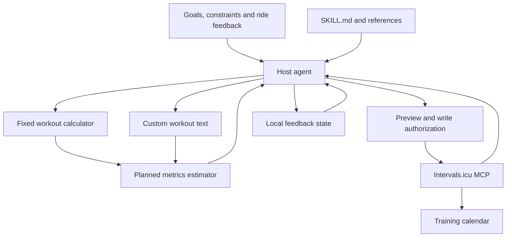

# Implementation Details

This document explains the planning workflow, numerical methods, MCP behavior and current implementation limits of Pro Cycling Plan & Workouts. It describes the code shipped in this repository; local showcase extensions are identified separately.

[English README](../README.en.md) · [Chinese README](../README.md)

## 1. Components and responsibilities

The system combines agent instructions with two independent Python tools and an optional account connection:

- **[SKILL.md](../SKILL.md) and [references](../references/):** define intake, goal-based periodization, workout selection, output requirements and feedback handling. The host agent reads and applies these instructions.
- **[src/tier_calculator.py](../src/tier_calculator.py):** implements `RiderProfile.analyze()`, fixed workout generation and a predefined weekly summary.
- **[scripts/plan_metrics.py](../scripts/plan_metrics.py):** parses supported workout text and estimates duration, mechanical work, energy expenditure, NP/TSS and optional three-zone PI.
- **[mcp/intervals_mcp_server.py](../mcp/intervals_mcp_server.py):** exposes account reads and calendar writes through a local stdio MCP server.



The host agent orchestrates this workflow. Installing a skill does not start an MCP server, authenticate an account or turn the fixed calculator into an eight-week optimizer. Editing instructions also does not change Python behavior.

## 2. Goal-based planning and feedback

The agent uses [goal-periodization.md](../references/goal-periodization.md) to translate a primary goal into phases and sessions:

1. Collect the goal, dates, recent training, available time, weekly TSS target/cap, distribution preference, recovery constraints and threshold information.
2. Arrange build, recovery, specific-work and assessment phases within the available dates.
3. Assign A/B/C priorities and select or author workouts that serve the goal. Priority and exercise intensity are separate concepts.
4. Expand the final steps and check duration, weekly totals, load and intensity distribution using the metrics tool where supported.
5. Preview the plan and use an authorized account connection for calendar writes.
6. Apply actual completion, RPE, fueling and recovery feedback before changing subsequent sessions.

Recovery and demonstrated capacity take precedence over template tiers. Added available hours are not automatically prescribed training hours. Missed training is not a TSS debt, and fatigue can justify canceling even an A-priority session.

The fixed CLI/MCP generation interface does not accept goal dates, race dates, cycle length, weekly TSS targets, PI targets or heat-adaptation settings. Those constraints are handled by the agent's planning workflow, not by a hidden optimization engine.

## 3. Fixed rider analysis and scaling

### FTP inputs and short-duration power

`RiderProfile.analyze()` requires CP60/FTP or CP20. It prefers CP60 when both are supplied. For CP20-only input, it first calculates a preliminary FTP as `CP20 × 0.95`; the optional CP1 ratio uses this preliminary value.

The current CP20 conversion branches are:

- CP1/preliminary FTP above 2.2: `effective FTP = CP20 × 0.92`.
- Ratio below 1.85: `effective FTP = CP20 × 0.96`.
- Otherwise, including missing CP1: `effective FTP = CP20 × 0.95`.

Explicit CP60/FTP bypasses these conversion branches. The returned `cp1_to_ftp_ratio` is based on preliminary FTP, not recalculated from the final adjusted FTP.

These factors and labels are legacy heuristics. Labels referring to a physiological phenotype or VLamax are not measurements or diagnoses. Prefer a valid FTP and consistent test protocol; a CP1 ratio cannot establish W′, VLamax or muscle-fiber composition.

### Tier and volume modifiers

The implementation rounds effective FTP/weight to two decimal places before tier comparison. Default `male` thresholds are 4.5 and 3.2 W/kg; the `female` branch uses 3.9 and 2.8. The Python class accepts `sex`, but the current CLI and MCP generation function do not expose it.

Base interval scales are 1.00 for Full Pro, 0.65 for Scaled and 0.45 for Double-Scaled. They are combined with:

- **Strength:** `none = 1.00`, `moderate = 0.80`, `heavy = 0.65`. Heavy strength also caps the recommended spike target at 130% FTP.
- **Age:** `<30 = 1.00`, `30–44 = 1.00`, `45–54 = 0.85`, `55+ = 0.75`. The latter three groups add 30/45/60 seconds of recovery; the two oldest groups contribute intensity offsets of −2/−4 percentage points.
- **Weekly hours:** endurance multipliers are 0.75, 1.00 and 1.20 for `0-5`, `5-10` and `10+`.
- **Environment:** indoor endurance multiplier 0.65 and intensity offset −3 percentage points; outdoor multiplier 1.00 and offset 0.

```text
interval_scale = max(0.30, round(base_scale × strength_scale × age_scale, 2))
endurance_scale = max(0.40, round(environment_scale × weekly_hours_scale, 2))
```

Model-specific rounding, minimum repetitions, duration floors and intensity floors then determine the emitted steps. An intensity offset is not a universal percentage reduction applied to every segment. These heuristics do not guarantee that the result fits an individual's actual schedule or recovery.

### Models and weekly summaries

Supported model identifiers are `lt1`, `fast_vo2`, `lt2`, `z3_z4_spikes`, `vo2_over_under`, `short_30_30` and `recovery`. The last model currently emits short primers as well as easy riding; the agent must not use that template blindly when fatigue calls for rest or genuinely easy recovery.

`generate_weekly_microcycle()` selects predefined days/models using the weekly-hours category. It does not solve for the requested hours, TSS, distribution, race goals or strength-training calendar. Its generated sessions also need review against the skill's planning rules.

The fixed generator estimates TSS and work using a model-specific assumed IF:

```text
estimated_TSS = round(hours × assumed_IF² × 100)
estimated_kJ = round(FTP × assumed_IF × hours × 3.6)
```

The second expression is a rough proxy, not integration of the emitted power steps. Some reported duration formulas also differ from their expanded text. Fixed carbohydrate recommendations are duration/model heuristics, not individualized fueling prescriptions. Recalculate the final text with the separate metrics estimator before reporting it as a step-based estimate.

## 4. Workout parsing and numerical estimates

### Supported text

`parse_workout()` supports constant/range `%FTP` steps and flat repeat groups ending in `Nx`. Blank lines or a new heading terminate the active group. Every step in a group is repeated, including a final recovery when it is present.

The README's [60-minute workout](../examples/climbing-surges-60m.txt) therefore repeats work/recovery twice, then explicitly adds the third effort. This avoids accidentally prescribing a third inter-repetition recovery.

Unsupported dash-prefixed steps raise an error rather than being silently discarded. Ramps, cadence targets, open-ended sprints, arbitrary step annotations and nested groups must first be converted into supported explicit steps. Duration must be positive, inputs finite, and a workout cannot exceed 48 hours.

### Work and energy expenditure

For a range, the default scenario uses the midpoint; `--range-scenarios` also calculates all-low and all-high target scenarios.

```text
power_W = FTP × target_percent / 100
work_kJ = Σ(power_W × duration_seconds) / 1000
kcal_low = work_kJ / (4.184 × 0.25)
kcal_high = work_kJ / (4.184 × 0.20)
```

The kcal range assumes 20–25% gross mechanical efficiency. It estimates ride energy expenditure, not daily energy needs or a requirement to replace every calorie during the ride. It is separate from carbohydrate, fluid and electrolyte guidance.

### NP, IF and TSS

The estimator expands targets into a one-second constant-power sequence. It uses complete trailing 30-second windows, averages the fourth powers of their means, then takes the fourth root:

```text
estimated_NP = mean(rolling_30s_mean(power)⁴)^(1/4)
IF = estimated_NP / FTP
TSS = duration_hours × IF² × 100
```

Sessions shorter than 30 seconds have no complete window, so NP/IF/TSS are unavailable. Average power is computed separately and is not substituted for NP.

`estimate_week()` sums per-session duration, work and TSS. It never computes one NP from a sequence stitched across sessions or rest days. Actual coasting, power variability, heat and local muscular fatigue are not captured fully by this target-based model. Platform calculation and rounding may also differ.

### Three-zone distribution and PI

Provide both LT1 and LT2 boundaries together, with LT1 below LT2. The estimator assigns target time at or below LT1 to the low zone, above LT1 through LT2 to the middle zone, and above LT2 to the high zone.

Let `p_low + p_mid + p_high = 1`, using fractions rather than percentages:

```text
PI = log10((p_low / p_mid) × p_high × 100)
```

- `polarized`: low > high > middle, all three zones are nonzero, and PI > 2.
- `pyramidal`: low > middle > high.
- Otherwise: `other_or_insufficient`.

If any zone has zero time, the tool reports PI as `null`; it does not add an artificial epsilon. A pyramidal classification can still accompany an undefined PI when high-zone time is zero.

Without individual physiological thresholds, either omit distribution or explicitly label a proxy scenario. The showcase's 70%/100% FTP boundaries are such a proxy, not measured LT1/LT2. Seven FTP power zones are not interchangeable with this three-zone system. Short-interval power-zone time does not measure high-oxygen-uptake time, and a higher PI alone is not evidence of a better plan.

## 5. MCP transport and account operations

### Runtime and authentication

The base server runs over local stdio and imports `FastMCP` from the MCP 1.x SDK. The README pins `mcp<2` for that interface. Dependencies must be installed in the interpreter configured by the host client.

At process startup it reads `INTERVALS_ATHLETE_ID` (default `i0`) and `INTERVALS_API_KEY` (default empty). Requests use the Intervals.icu athlete API over HTTPS, HTTP Basic authentication with username `API_KEY`, JSON payloads and a 15-second timeout. The base implementation uses Python's standard-library HTTP client.

Keep real credentials in private client configuration. An installed skill, a successful server handshake, a successful account read, a calendar write and a device sync are distinct verification steps.

### Exposed tools

- **`get_athlete_profile()`** requests the athlete endpoint and returns ID, name, weight and sport settings. FTP-related fields depend on returned settings; eFTP and W′ are not explicitly extracted by this wrapper.
- **`get_recent_wellness_and_activities(oldest_date, newest_date)`** requests `/activities` and `/wellness` for the date range. Missing activities may reflect data-source restrictions or incomplete syncing. Returned load metrics do not independently diagnose a fatigue cause.
- **`create_intervals_workout(target_date, name, description_code, moving_time_sec=4500)`** sends `POST /events` with category `WORKOUT`, local midnight on the target date, type `Ride`, name, description and duration in seconds. The caller must pass the duration of the final expanded workout.
- **`generate_and_push_pro_workout(...)`** calls the fixed calculator and immediately posts the result. It defaults to CP20 input; set `is_cp20=false` for FTP/CP60. Indoor workouts use `VirtualRide`, outdoor workouts `Ride`. It does not read recent wellness or offer a preview-only mode, and it passes through the fixed generator's reported duration and estimates.

### Write and verification boundaries

The base server does not implement calendar lookup, update/delete tools, stable external IDs, duplicate prevention or safe retries after an ambiguous write response. Check the calendar before repeating an uncertain request.

The README showcase used a separate local extension for batch writes, stable identifiers and calendar read-back. Those capabilities are not shipped as part of the four base tools. The public showcase is evidence of that workflow, not a claim that the base server gained those features.

A calendar event alone does not prove that its structured steps parsed correctly. Verify date, duration, power targets, expanded repeats and recovery counts. Garmin, Wahoo, Zwift and other device integrations require separate verification. Future fitness/fatigue projections in the screenshot are not completed-training outcomes.

### Connection diagnosis

- Missing `mcp.server` or `FastMCP`: check the exact interpreter and SDK compatibility.
- Startup failure: inspect absolute paths, JSON/TOML syntax and host logs.
- Missing API key: check the server's environment configuration, then restart it.
- HTTP 401/403: inspect credentials, account permissions and the response source; network protection can also generate a 403.
- Calendar/device mismatch: inspect parsed structure before investigating downstream sync.

## 6. State, feedback and privacy

The [feedback workflow](../references/feedback-loop.md) uses whole-session/final-set RPE, completion, fueling, muscular or breathing limitations, sleep and heat context. A rider's suspected cause is a hypothesis, not a diagnosis from a single failed workout.

When writable storage is available, actual feedback and preferences can be saved to `.training-state/state.json` in the training directory. This directory is Git-ignored. Without persistence, provide a copyable continuation summary rather than claiming automatic memory across new chats.

The metrics tool and fixed generator do not automatically load this state. The agent uses it to revise future sessions. Completed activities must not be rewritten to fit a new plan, and a local revision is not proof that the calendar was updated.

Keep `.env`, `.venv/`, private account responses and raw training state out of public commits. Examples should contain only intentionally published data and clearly distinguish assumptions, planned estimates, observed results and platform projections.

## 7. Source map and maintenance

- Change goal mapping, phases and assessment guidance in [goal-periodization.md](../references/goal-periodization.md).
- Change load/distribution guidance in [load-and-distribution.md](../references/load-and-distribution.md).
- Maintain source workouts and ambiguities in [image-workouts.md](../references/image-workouts.md).
- Change fixed rider analysis and workout generation in [tier_calculator.py](../src/tier_calculator.py).
- Change supported text and numerical methods in [plan_metrics.py](../scripts/plan_metrics.py).
- Change account requests and exposed tools in [intervals_mcp_server.py](../mcp/intervals_mcp_server.py).
- Keep the Chinese and English README showcases, commands and linked resources aligned when behavior changes.

The reference documents contain the underlying training guidance and external sources. The implementation above is a planning aid; it does not guarantee adaptation, physiological classification or deployment-wide behavior across every host.

---

[Return to the English README](../README.en.md) · [Return to the Chinese README](../README.md)
